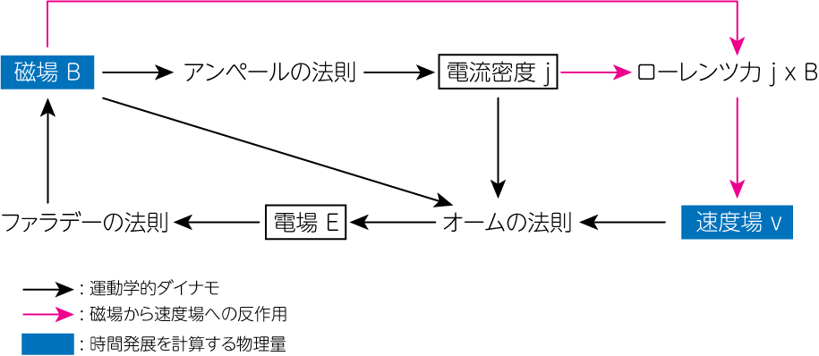
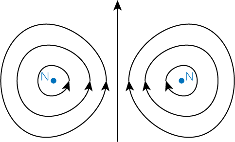
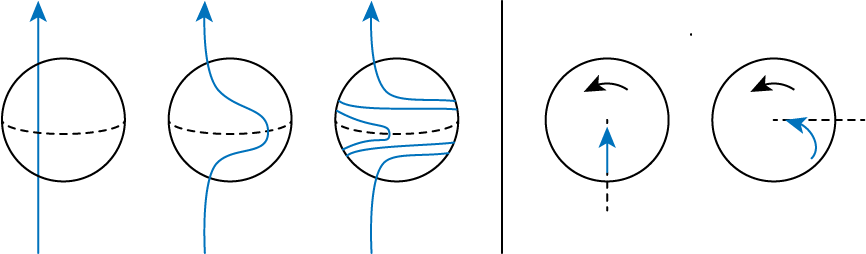

{: .no_toc }

  

    Table of contents
  

  {: .text-delta }
1. TOC
{:toc}

 

# ダイナモ理論の概要と反ダイナモ定理

ここでは、太陽の周期活動や銀河磁場の維持・増幅機構を説明する理論である、ダイナモ理論について勉強したことをメモします。

## ダイナモ理論の概要

ダイナモとは、ガスの運動により磁力線が引き伸ばされたりねじられたりすることで、磁場を増幅し、ガスの運動エネルギーを磁場エネルギーに変換する物理機構を意味します。
太陽の場合、対流層での熱対流運動と太陽自身の自転運動が、そのエネルギー源となっています。
同様の機構は、恒星でも起こっていると考えられます。
さらに銀河磁場についてもダイナモが研究されており、そのエネルギー源は、銀河円盤の差動回転や恒星からの恒星風や超新星爆発などによる星間物質の噴き上げ (このようにしてできた構造をバブルとも呼びます) などが考えられます。  
ダイナモ理論は、磁場とガスの相互作用をどのように扱うかを考えることで、大まかに 2 つに分類されます。
磁場が弱い極限を考えることで、磁場の変形に伴う速度場への反作用を考慮せず、与えられた速度場のもとで磁場がどのように時間発展をするかのみを解く場合を、運動学的ダイナモ (kinematic dynamo) と呼びます。
一方、速度場と磁場を同時に解き、相互作用を矛盾なく取り入れる方法を、MHD ダイナモまたは 力学的ダイナモなどと呼びます。  
ダイナモ理論では、磁場を横切るようなプラズマの運動により発生する電流により、磁場が維持されると考えます。
プラズマの運動速度 $$\mathbf{v}$$ と磁場 $$\mathbf{B}$$ から、誘導電場 $$\frac{\mathbf{v}}{c} \times \mathbf{B}$$ が発生します。
そしてこれが、オームの法則 $$\mathbf{j} = \sigma (\mathbf{E} + \frac{\mathbf{v}}{c} \times \mathbf{B})$$ から、電流密度 $$\mathbf{j}$$ を生み出すのです。
またこのようにして生まれた電流は、アンペールの法則 $$\nabla \times \mathbf{B} = \frac{4\pi}{c} \mathbf{j}$$ を通して、新たに磁場を生成します。
最後に、この磁場の時間変化は、ファラデーの法則 $$\nabla \times \mathbf{E} = - \frac{1}{c} \frac{\partial \mathbf{B}}{\partial t}$$ から電場を、そしてローレンツ力 $$\mathbf{j} \times \mathbf{B}$$ からプラズマの運動 $$\mathbf{v}$$ に影響を及ぼす力を生み出します。
この関係をまとめたものを、下図に示します。

  
プラズマと磁場の相互作用の関係図。  

このように考えると、MHD ダイナモは非線形な連立微分方程式を解かねばならず、とても複雑です。
一方、磁場から速度場への反作用を考えないと仮定した運動学的ダイナモでは、磁場の時間発展は、誘導方程式のみから与えられます。

$$
\frac{\partial \mathbf{B}}{\partial t} 
= \nabla \times (\mathbf{v} \times \mathbf{B}) + \eta \nabla^2 \mathbf{B} \tag{1}
$$

運動学的ダイナモでは、速度場 $$\mathbf{v}$$ が時間・空間の関数として与えられているため、誘導方程式は $$\mathbf{B}$$ についての線型方程式となり、解析的に取り扱うことができます。

## カウリングの反ダイナモ定理 (Cowling's anti-dynamo theorem)

### ゼロ点の積分からの証明

ダイナモ問題は、扱う変数が多いため、そのまま解くのは複雑です。
ここに定常性や対称性などを課すことで変数を削減し、問題を簡単化しようという試みがなされてきました。
例えば太陽や銀河の場合、ある角速度で自転しているため、これらの磁場活動を簡単に (大雑把に) 説明するには、軸対称の仮定が適当だろうと思われます。
また太陽や銀河などの活動は長期間の時間スケールで行われていることから、定常的な流れも仮定して構わないだろうと考えられます。
しかし、これらの仮定のもとでのダイナモは成り立たないということを、カウリングが 1933 年に示しています。  
軸対称かつ定常な磁場を考え、次のようにトロイダル成分 $$B_\varphi$$ とポロイダル成分 $$\mathbf{B}_p$$ に分けましょう。

$$
\mathbf{B} 
= B_\varphi \mathbf{e}_\varphi + \mathbf{B}_p \tag{2}
$$

ポロイダル成分磁場のみを考えると、軸対称性から、その磁力線は子午面内で必ず閉じているはずです。
そして子午面内に必ず、ポロイダル磁場がゼロとなる点が存在します。
この点を N と表すことにします。

  
軸対称な磁場を持つ系の、子午面内での磁力線。
N はポロイダル磁場がゼロとなる点 (neutral points) を表す。  

すなわち、この N 点ではトロイダル磁場成分しか持ちません。
オームの法則 $$\frac{\mathbf{j}}{\sigma} = \mathbf{E} + \frac{\mathbf{v}}{c} \times \mathbf{B}$$ を、N 点を通るリング状の磁力線に沿った経路 $$c$$ で積分しましょう。

$$
\oint_c \frac{\mathbf{j}}{\sigma} \cdot d\mathbf{s} 
= \underbrace{\oint_c \mathbf{E} \cdot d\mathbf{s}}_{ストークスの定理} + \oint_c \left( \frac{\mathbf{v}}{c} \times \mathbf{B} \right) \cdot d\mathbf{s} 
= \iint_S (\nabla \times \mathbf{E}) \cdot d\mathbf{S} + \oint_c \left( \frac{\mathbf{v}}{c} \times \mathbf{B} \right) \cdot d\mathbf{s} \tag{3}
$$

途中、ストークスの定理を用いた変形を行い、閉経路 $$c$$ が囲む面を $$S$$ としました。
第一項の被積分関数は、ファラデーの法則と定常の仮定から

$$
\nabla \times \mathbf{E} 
= - \frac{1}{c} \frac{\partial \mathbf{B}}{\partial t} 
= \mathbf{0} \tag{4}
$$

のようにゼロとなります。
また、第二項は磁場に沿った積分経路であることから、やはりゼロです。
すなわち $$\oint_c j_\varphi ds = 0$$ であることを意味します。
しかし、アンペールの法則から

$$
\mathbf{j} 
= \frac{c}{4\pi} \nabla \times \mathbf{B} \tag{5}
$$

であることを考慮すると、ポロイダル磁場成分 $$\mathbf{B}_p$$ が存在することと矛盾します。
したがって、そもそもの家庭が間違っており、定常・軸対称な磁場が維持できないことがわかります。
これをカウリングの反ダイナモ定理 (Cowling's anti-dynamo theorem) と呼びます。
カウリングの定理は、ダイナモ理論が必ず非軸対称性を持つ、または非定常でなければならない (あるいはその両方) であることを要求します。
このような非軸対称性や非定常性は、天体ダイナモの場合、局所的な乱流や天体スケールの大局的な運動により生じると考えられます。  

 

### 軸対称な誘導方程式からの理解

この反ダイナモ定理は、軸対称系の誘導方程式からも理解することができます。
ここでは、円筒座標 $$(R, \varphi, z)$$ を用います。
さらに軸対称な系を考えているため、全ての物理量は $$\varphi$$ に依存しません。
先ほどと同様、磁場を $$\mathbf{B} = \mathbf{B}_p + B_\varphi \mathbf{e}_\varphi$$ のように、ポロイダル磁場とトロイダル磁場に分解しましょう。
速度場についても同様に、$$\mathbf{v} = \mathbf{v}_p + v_\varphi \mathbf{e}_\varphi$$ のように、ポロイダル成分とトロイダル成分に分解して書き表しております。
また、ベクトルポテンシャルを導入しましょう。
$$\frac{\partial}{\partial \varphi} = 0$$ となるため、ポロイダル磁場は

$$
\mathbf{B}_p 
= \nabla \times (A_\varphi \mathbf{e}_\varphi) 
= - \frac{\partial A_\varphi}{\partial z} \mathbf{e}_R + \frac{1}{R} \frac{\partial}{\partial R} (R A_\varphi) \mathbf{e}_z \tag{6}
$$

となります。
ポロイダル成分の誘導方程式より

$$
\frac{\partial}{\partial t} \{ \nabla \times (A_\varphi \mathbf{e}_\varphi)\} 
= \nabla \times [\mathbf{v} \times \{\nabla \times (A_\varphi \mathbf{e}_\varphi)\}] + \eta \nabla^2 \{\nabla \times (A_\varphi \mathbf{e}_\varphi)\} \tag{7}
$$

です。
$$\eta$$ は空間の至る所で一定の値をとるとすると、(7)式右辺の第二項において $$\nabla \times$$ を外に出すことができて

$$
\frac{\partial}{\partial t} (A_\varphi \mathbf{e}_\varphi) 
= \mathbf{v} \times \{ \nabla \times (A_\varphi \mathbf{e}_\varphi)\} + \eta \nabla^2 (A_\varphi \mathbf{e}_\varphi) \tag{8}
$$

のようになります。
(8) 式の右辺第一項において、(6)式の最右辺を代入すれば

$$
\begin{align}
\mathbf{v} \times \{\nabla \times (A_\varphi \mathbf{e}_\varphi)\} 
&= \mathbf{v} \times \left\{ - \frac{\partial A_\varphi}{\partial z} \mathbf{e}_R + \frac{1}{R} \frac{\partial}{\partial R} (R A_\varphi) \mathbf{e}_z \right\} \notag \\
&= v_\varphi \frac{\partial A_\varphi}{\partial z} \mathbf{e}_z - v_z \frac{\partial A_\varphi}{\partial z} \mathbf{e}_\varphi - \frac{v_R}{R} \frac{\partial}{\partial R} (R A_\varphi) \mathbf{e}_\varphi + \frac{v_\varphi}{R} \frac{\partial}{\partial R} (R A_\varphi) \mathbf{e}_R \tag{9}
\end{align}
$$

となります。
必要なのは $$\mathbf{e}_\varphi$$ 方向 であるため、(9) 式から $$\varphi$$ 成分のみを抜き出して整理しましょう。

$$
\begin{align}
[\mathbf{v} \times \{\nabla \times (A_\varphi \mathbf{e}_\varphi)\}]_\varphi 
&= - v_z \frac{\partial A_\varphi}{\partial z} - \frac{v_R}{R} \frac{\partial}{\partial R} (RA_\varphi) 
= - \frac{v_z}{R} \frac{\partial }{\partial z} (R A_\varphi)- \frac{v_R}{R} \frac{\partial}{\partial R} (RA_\varphi) \notag \\
&= - \frac{\mathbf{v}_p \cdot \nabla}{R} (R A_\varphi) \tag{10}
\end{align}
$$

そして (8) 式の右辺第二項 $$\nabla^2 (A_\varphi \mathbf{e}_\varphi)$$ の計算ですが、$$\mathbf{e}_\varphi = (-\sin \varphi, \cos \varphi, 0)$$ は $$\varphi$$ に依存するため、注意が必要です。

$$
\begin{align}
\nabla^2 (A_\varphi \mathbf{e}_\varphi) 
&= (\nabla^2 A_\varphi) \mathbf{e}_\varphi + A_\varphi (\nabla^2 \mathbf{e}_\varphi) 
= (\nabla^2 A_\varphi) \mathbf{e}_\varphi + A_\varphi \left( \frac{1}{R^2} \frac{\partial^2}{\partial \varphi^2} \mathbf{e}_\varphi \right) \notag \\
&= (\nabla^2 A_\varphi) \mathbf{e}_\varphi - \frac{A_\varphi}{R^2} \mathbf{e}_\varphi 
= \left\{ \left( \nabla^2 - \frac{1}{R^2}\right) A_\varphi \right\} \mathbf{e}_\varphi \tag{11}
\end{align}
$$

以上から、最終的に

$$
\frac{\partial A_\varphi}{\partial t} 
= - \frac{\mathbf{v}_p \cdot \nabla}{R} (R A_\varphi) + \eta \left( \nabla^2 - \frac{1}{R^2} \right) A_\varphi \tag{12}
$$

を得ます。
同様に、トロイダル成分についても、方程式を整理しましょう。

$$
\frac{\partial }{\partial t} (B_\varphi \mathbf{e}_\varphi)
= [\nabla \times (\mathbf{v} \times \mathbf{B})]_\varphi + \eta \nabla^2 (B_\varphi \mathbf{e}_\varphi) 
= [\nabla \times (\mathbf{v} \times \mathbf{B})]_\varphi + \eta \left\{ \left( \nabla^2 - \frac{1}{R^2} \right) B_\varphi \right\} \mathbf{e}_\varphi \tag{13}
$$

途中、右辺第二項において (11) 式と同じ計算を行いました。
右辺第一項について、整理しましょう。
簡単のため、非圧縮 $$(\nabla \cdot \mathbf{v} = 0)$$ とすると

$$
\begin{align}
\nabla \times (\mathbf{v} \times \mathbf{B})
&= \epsilon_{ijk} \partial_j (\epsilon_{k\ell m} v_\ell B_m) \mathbf{e}_i
= \partial_j (\epsilon_{kij} \epsilon_{k\ell m} v_\ell B_m) \mathbf{e}_i \notag \\
&= \partial_j \{ (\delta_{i\ell} \delta_{jm} - \delta_{im} \delta_{j\ell}) v_\ell B_m \} \mathbf{e}_i 
= \partial_j ( v_i B_j - v_j B_i) \mathbf{e}_i \notag \\
&= B_j (\partial_j v_i) \mathbf{e}_i + (\partial_j B_j) v_i \mathbf{e}_i - (\partial_j v_j) B_i \mathbf{e}_i - v_j (\partial_j B_i) \mathbf{e}_i \notag \\
&= (\mathbf{B} \cdot \nabla) \mathbf{v} + \underbrace{(\nabla \cdot \mathbf{B})}_{=0} \mathbf{v} - \underbrace{(\nabla \cdot \mathbf{v})}_{=0} \mathbf{B} - (\mathbf{v} \cdot \nabla) \mathbf{B} \notag \\
&= (\mathbf{B} \cdot \nabla) \mathbf{v} - (\mathbf{v} \cdot \nabla) \mathbf{B} \tag{14}
\end{align}
$$

が成り立ちます。
円筒座標について成り立つベクトル恒等式より

$$
(\mathbf{A} \cdot \nabla ) \mathbf{C} 
= \left\{ (\mathbf{A} \cdot \mathrm{grad}) C_R - \frac{A_\varphi C_\varphi}{R}\right\} \mathbf{e}_R + \left\{ (\mathbf{A} \cdot \mathrm{grad}) C_\varphi + \frac{A_\varphi C_R}{R}\right\} \mathbf{e}_\varphi + \{(\mathbf{A} \cdot \mathrm{grad}) C_z \} \mathbf{e}_z \tag{15}
$$

であることを用いましょう。
ここで $$\mathrm{grad} = (\frac{\partial}{\partial R}, \frac{1}{R} \frac{\partial}{\partial \varphi}, \frac{\partial}{\partial z})$$ です。

{: .note}
$$\nabla$$ による微分が $$\mathbf{C} = \sum_i C_i \mathbf{e}_i$$ の基底ベクトルにも作用するために、$$-\frac{A_\varphi C_\varphi}{R}, \frac{A_\varphi C_R}{R}$$ のような余分な項も現れることに注意しましょう。前者は遠心力、後者はコリオリ力に相当する項です。

また軸対称系を考えているため、$$\frac{\partial}{\partial \varphi} = 0$$ であることから、$$\mathbf{B} \cdot \mathrm{grad} = \mathbf{B}_p \cdot \mathrm{grad}, \mathbf{v} \cdot \mathrm{grad} = \mathbf{v}_p \cdot \mathrm{grad}$$ となることを用いると

$$
\frac{\partial B_\varphi}{\partial t} 
= \left\{ (\mathbf{B}_p \cdot \mathrm{grad}) v_\varphi + \frac{B_\varphi v_R}{R} \right\} - \left\{ (\mathbf{v}_p \cdot \mathrm{grad}) B_\varphi + \frac{v_\varphi B_R}{R}\right\} + \eta \left( \nabla^2 - \frac{1}{R^2} \right) B_\varphi \tag{16}
$$

となります。
さらに

$$
(\mathbf{B}_p \cdot \mathrm{grad}) R 
= \left(B_R \frac{\partial}{\partial R} + B_z \frac{\partial}{\partial z}\right) R 
= B_R \tag{17}
$$

であることを用いると

$$
R (\mathbf{B}_p \cdot \mathrm{grad}) \frac{v_\varphi}{R} 
= (\mathbf{B}_p \cdot \mathrm{grad}) v_\varphi - \frac{v_\varphi B_R}{R} \tag{18}
$$

のように式変形することができます。
同様に

$$
R (\mathbf{v}_p \cdot \mathrm{grad}) \frac{B_\varphi}{R} 
= (\mathbf{v}_p \cdot \mathrm{grad}) B_\varphi - \frac{B_\varphi v_R}{R} \tag{19}
$$

より、最終的に (16) 式が

$$
\frac{\partial B_\varphi}{\partial t} 
= R (\mathbf{B}_p \cdot \nabla) \frac{v_\varphi}{R} - R (\mathbf{v}_p \cdot \nabla) \frac{B_\varphi}{R} + \eta \left( \nabla^2 - \frac{1}{R^2}\right) B_\varphi \tag{20}
$$

のように整理されます。
途中、$$\mathrm{grad} \rightarrow \nabla$$ のように書き換えました。  
ポロイダル磁場 $$\mathbf{B}_p = \nabla \times (A_\varphi \mathbf{e}_\varphi)$$ の時間発展を表す式 (12) 式を見ると、右辺第一項がポロイダル運動による磁場の移流を表し、第二項が磁気拡散を表しています。
(12) 式には、移流と拡散の効果しか入っておらず、$$A_\varphi$$ を生成する源泉項が存在しません。
よって長時間経つと、$$A_\varphi \rightarrow 0$$ となることがわかります。
トロイダル磁場の時間発展式 (20) の右辺第一項は、ポロイダル成分からトロイダル成分が生み出されることがわかります。
よって、トロイダル磁場は一方的に減少することはありませんが、長時間経つと $$A_\varphi \rightarrow 0$$ となることから、いずれはこの右辺第一項もゼロとなります。
最終的に $$B_\varphi$$ の時間発展も移流・拡散方程式となり、最終的に $$B_\varphi \rightarrow 0$$ になることがわかります。
以上から、反ダイナモ定理を誘導方程式から理解することができました。

## ゼルドビッチの反ダイナモ定理 (Zeldovich's anti-dynamo theorem)

カウリングの定理が「軸対称な定常的な流れでは磁場を維持できない」ことを主張していたのに対し、こちらは「2 次元の平面的な非圧縮流れでは磁場を維持できない」ことを示したものです。
カウリングの定理のデカルト座標系版、と言っても良いでしょう。
流体の速度を $$\mathbf{v} = (v_x, v_y, 0)$$ のように書くことにします。
また流れが非圧縮であることから、$$\nabla \cdot \mathbf{v} = 0$$ を満たします。
すると、誘導方程式から

$$
\begin{align}
\frac{\partial \mathbf{B}}{\partial t} 
= \nabla \times (\mathbf{v} \times \mathbf{B}) + \eta \nabla^2 \mathbf{B}
\underbrace{=}_{(14)} (\mathbf{B} \cdot \nabla) \mathbf{v} - (\mathbf{v} \cdot \nabla) \mathbf{B} + \eta \nabla^2 \mathbf{B} \tag{21}
\end{align}
$$

です。
$$z$$ 成分を考えると、$$v_z = 0$$ より

$$
\frac{\partial B_z}{\partial t} 
= - (\mathbf{v} \cdot \nabla) B_z + \eta \nabla^2 B_z \tag{22}
$$

(22) 式は、$$B_z$$ の時間発展が、移流と拡散により与えられることを示しています。
$$B_z$$ を生成する源泉項が存在しないことから、時間が十分経てば、$$B_z \rightarrow 0$$ となることがわかります。
$$B_z = 0$$ となったとき、磁場の発散から $$\frac{\partial B_x}{\partial x} + \frac{\partial B_y}{\partial y} = 0$$ のようになります。
すると磁場は、ベクトルポテンシャルを用いて $$\mathbf{B} = \nabla \times (A_z \mathbf{e}_z)$$ と書くことができます。
よって、ゲージを適切に選ぶことで、$$A_z$$ の時間発展についても

$$
\frac{\partial A_z}{\partial t} + (\mathbf{v} \cdot \nabla) A_z 
= \eta \nabla^2 A_z \tag{23}
$$

のように書くことができます。
すなわち、十分時間が経てば、$$A_z$$ も移流しながら拡散していき、$$B_x, B_y$$ もゼロになることがわかります。  
ここで行った計算では、流れは $$v_z = 0$$ であることを課しているだけで、$$v_x, v_y$$ が $$z$$ に依存していても、結果は変わりません。
つまり、層ごとに水平方向に流体が異なる方向に流れているような 3 次元的な構造を持っていても、ダイナモは発生しないことを主張しています。
ダイナモには、$$xy$$ 平面から飛び出すような、面外への運動が必要となることがわかります。

## $$\Omega$$ 効果とその限界

太陽表面の観測から、その自転速度は一様ではないことが知られています。
赤道付近が最も速く自転しており、その自転周期は 26 日とされています。
これに対し、極付近の自転周期は 37 日とされています。
太陽に限らず、宇宙を広く見渡すと、銀河円盤や降着円盤も差動回転しています。
このような差動回転から、磁場を生み出す効果として考案されたのが、$$\Omega$$ ダイナモ効果です。  
今、太陽内部を一様なポロイダル磁場が貫いている状況を考えましょう。
極付近に比べ、赤道付近が速く回転していることから、磁場が中緯度付近で強くねじられ、トロイダル成分が生成されます。
この考え方は、地磁気生成・維持のために考えられた研究を、太陽に応用したものです。  
銀河円盤や降着円盤についても、同じことが言えます。
簡単のため、円盤内に動径方向に貫く磁力線が存在しているとすると、これが円盤の差動回転により巻き込まれ、太陽と同様に方位各方向の磁場が生成されます。

  
太陽 (左) と銀河円盤や降着円盤 (右) で発生する $$\Omega$$ 効果の概略図。太陽では、赤道付近が自転角速度が速い。銀河円盤や降着円盤では、中心付近が角速度が速い。  

この効果は、(20) 式の右辺第一項の効果と考えることができます。
しかし、この $$\Omega$$ 効果だけで磁場の生成・増幅・維持を説明するのは、困難なことが知られています。
理想 MHD の場合、磁場は流体に凍結しています。
また簡単のため、非圧縮を考えると

$$
\frac{B_\varphi}{B_R} 
= \frac{\delta \ell_\varphi}{\delta \ell_R} \tag{24}
$$

のように、$$R$$ 方向と $$\varphi$$ 方向の微小変位 $$\delta \ell_R, \delta \ell_\varphi$$ で書くことができます。
先ほどの円盤の図のように、初期に動径方向を向いていた短い磁力線を考えると、中心に近い側と遠い側で角速度が異なるため、時間 $$t$$ 後には方位角方向の位置がズレます。
すると、$$\delta \ell_\varphi = R \frac{d\Omega}{dR} \delta \ell_R t$$ のように書くことができます。
円盤は方位角方向にのみ運動をしていると考えて、動径方向の運動はないとすると、$$\delta \ell_R$$ は一定と考えることができます。
よって

$$
\frac{B_\varphi}{B_R} 
= R \frac{d\Omega}{dR} t \ \Longrightarrow \ 
B_\varphi 
= R \frac{d\Omega}{dR} B_R t \tag{25}
$$

のようになります。
$$R$$ 方向の運動は考えていないため、$$B_R$$ は時間に依存せず一定とすると、$$B_\varphi$$ は時間 $$t$$ に線形に成長することがわかります。
実際には乱流による拡散も存在するため、$$\Omega$$ 効果による増幅は期待できないか、もし増幅できたとしても極めて遅い成長率となります。
このことからもわかるように、ダイナモ機構による磁場の増幅・維持は、2 次元的な流れだけでは不可能であり、3 次元的な効果が必要となることがわかります。

## 参考文献

[1] [Rincon, 2019, "Dynamo theories"](https://doi.org/10.1017/S0022377819000539)  
[2] [Brandenburg & Ntormousi, 2023, "Galactic Dynamos"](https://doi.org/10.1146/annurev-astro-071221-052807)  
[3] [Priest, "Solar Magnetohydrodynamics"](https://link.amazon/B00sd4tXP)  
[4] [Priest, "Magnetohydrodynamics of the Sun"](https://link.amazon/B02l5xA77)  
[5] [桜井隆, 小島正宜, 小杉健郎, 柴田一成, "太陽"](https://link.amazon/B06J1skYa)  
[6] [柴田一成, 横山央明, 工藤哲洋, "宇宙電磁流体力学の基礎"](https://link.amazon/B00e7dDcc)  
[7] [柴田一成, 福江純, 松元亮治, 嶺重慎, "活動する宇宙 -天体活動現象の物理-"](https://link.amazon/B03DN6O3N)  

