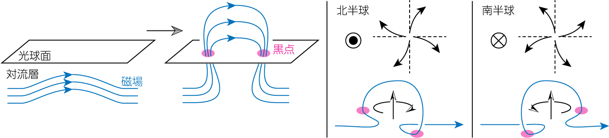
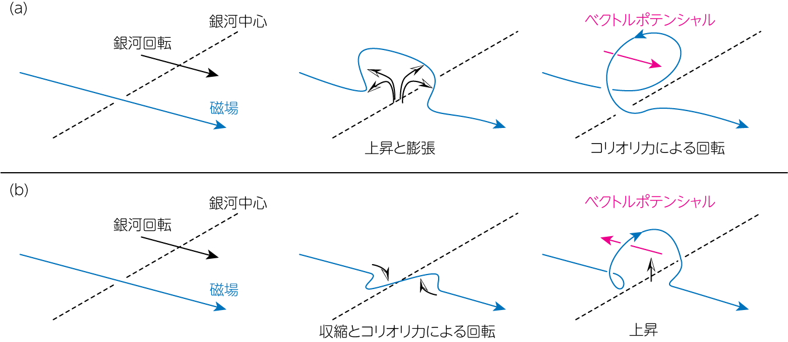
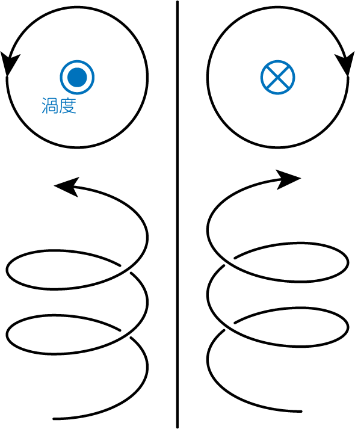

{: .no_toc }

  

    Table of contents
  

  {: .text-delta }
1. TOC
{:toc}

 

# 平均場電気力学と $$\alpha$$ 効果

## パーカーの $$\alpha \Omega$$ ダイナモ

カウリングの反ダイナモ定理を克服するには、定常・軸対称という仮定のどちらか一方でも緩和する必要があります。
そこで、パーカーは次のようなモデルを考えました。  
太陽の場合、[$$\Omega$$ 効果]()により増幅されたトロイダル磁場は、[磁気浮力]()により太陽表面に上昇します。
このとき、周囲の圧力が低下するため、磁束管は膨張をします。
太陽の自転を考慮すると、膨張運動するガスはコリオリ力 $$ - \boldsymbol{\Omega} \times \mathbf{v}$$ を受けます。

  
太陽での[磁気浮力]()と $$\alpha \Omega$$ ダイナモ。
左パネルは[磁気浮力]()による磁束管の上昇・膨張、右パネルは北半球と南半球でのコリオリ力による磁力線のねじれ方向を表す。  

太陽の北半球 (極から見た時に自転が反時計回りに見える) では、運動するガスにはその進行方向を右に曲げるようなコリオリ力が働きます。
磁場がガスに凍結している場合、ガスと一緒に磁力線も動くため、磁力線はねじられ、ポロイダル成分が生じます。
このようにして生じるポロイダル成分は、その浮上した磁場付近に生じる一時的・局所的なものです。
しかし、同様に生じた周囲のポロイダル磁場と磁気リコネクションすることにより、大局的なポロイダル磁場を作り出すことができると考えられます。  
銀河円盤についても、同様に考えることができます。

  
銀河円盤で起こる $$\alpha \Omega$$ ダイナモ。
(a) 最初に超新星爆発が起こり磁場が磁力線が上昇する場合と、(b) 最初に重力収縮が起こり恒星からの恒星風により磁力線が上昇する場合。  

太陽と同様に、[$$\Omega$$ 効果]()により増幅されたトロイダル磁場が、銀河面上空のハロー方向に浮上します。
(a) の場合、まずトロイダル磁場が[磁気浮力]()や乱流、恒星風や超新星爆発により、ハロー方向に噴出されます。
このとき、ハローは密度が低いために膨張運動を起こし、それに伴ってコリオリ力による回転運動も行います。
このようにして、ハロー内に動径方向の磁場が生まれます。
(b) の場合、トロイダル磁場が存在する場所で、ガスが重力収縮を起こします。
するとコリオリ力により磁力線が回転し、磁場の向きが変化します。
その後、何らかの作用により磁力線が浮上することで、動径方向の磁場が生まれます。
しかし (a) と (b) では、新たに生成された動径方向の磁場の向きが反対になることに注意しましょう。
太陽の場合は、北半球か南半球かで磁場の向きが決まっていましたが、銀河の場合は銀河面の上側か下側かだけでなく、上昇・膨張が先に起こるか収縮が先に起こるかによっても向きが変化します。  
注目していただきたいのは、先ほどの図の (a), (b) において、元の磁場と同じ方向に沿ったベクトルポテンシャルが生成されていることです。
種となるトロイダル磁場に (符号は違えど) ほぼ比例するベクトルポテンシャルが生じると考えられるため、[軸対称の場合のベクトルポテンシャルの時間発展の式 (12)](/mhd/anti_dynamo_theorem#軸対称な誘導方程式からの理解) に、次のような新しい項を付け加えることにします。

$$
\frac{\partial A_\varphi}{\partial t} 
= - \frac{\mathbf{v}_p \cdot \nabla}{R} (RA_\varphi) + \eta \left( \nabla^2 - \frac{1}{R^2} \right) A_\varphi + \alpha B_\varphi \tag{1}
$$

新しい項の係数 $$\alpha$$ の名前から、この効果を $$\alpha$$ ダイナモ効果と呼びます。
またこの式と[軸対称の場合のベクトルポテンシャルの時間発展の式 (20)](/mhd/anti_dynamo_theorem#軸対称な誘導方程式からの理解) を合わせて、ダイナモ方程式とも呼びます。

## 平均場電気力学

先ほどは、経験的に係数 $$\alpha$$ を持つ項を導入しましたが、ここでは平均場の枠組みから、$$\alpha$$ の意味を説明してみましょう。
磁場と速度場とを、平均場部分 $$\langle \mathbf{B} \rangle, \langle \mathbf{v} \rangle$$ と、ゆらぎの部分 $$\mathbf{B}', \mathbf{v}'$$ とに分けましょう。
すなわち

$$
\mathbf{B} 
= \langle \mathbf{B} \rangle + \mathbf{B}', \quad
\mathbf{v} 
= \langle \mathbf{v} \rangle + \mathbf{v}' \tag{2}
$$

のように書くことにします。
ただし、演算子 $$\langle \cdots \rangle$$ はアンサンブル平均を表し、これらの量は、次のようなレイノルズ則 (Reynolds rules) を満たします。

$$
\begin{align}
&\langle \mathbf{v}_1 + \mathbf{v}_2 \rangle 
= \langle \mathbf{v}_1 \rangle + \langle \mathbf{v}_2 \rangle, \quad 
\langle \langle \mathbf{v} \rangle \rangle 
= \langle \mathbf{v} \rangle, \quad 
\langle \langle \mathbf{v}_1 \rangle \langle \mathbf{v}_2 \rangle \rangle 
= \langle \mathbf{v}_1 \rangle \langle \mathbf{v}_2 \rangle, \quad 
\langle \langle \mathbf{v} \rangle \mathbf{v}' \rangle = 0, \notag \\
&\left\langle \frac{\partial \mathbf{v}}{\partial t} \right\rangle 
= \frac{\partial \langle \mathbf{v} \rangle}{\partial t}, \quad 
\left\langle \frac{\partial \mathbf{v}}{\partial x} \right\rangle 
= \frac{\partial \langle \mathbf{v} \rangle}{\partial x} \notag 
\end{align} \tag{3}
$$ 

これらを、誘導方程式に代入しましょう。

$$
\begin{align}
\frac{\partial}{\partial t} ( \langle \mathbf{B} \rangle + \mathbf{B}')
&= \nabla \times \{(\langle \mathbf{v}\rangle + \mathbf{v}') \times (\langle \mathbf{B}\rangle + \mathbf{B}') \} + \eta \nabla^2 (\langle \mathbf{B} \rangle + \mathbf{B}') \notag \\
&= \nabla \times (\langle \mathbf{v}\rangle \times \langle \mathbf{B}\rangle + \langle \mathbf{v}\rangle \times \mathbf{B}' + \mathbf{v}' \times \langle \mathbf{B}\rangle + \mathbf{v}' \times \mathbf{B}') + \eta \nabla^2 (\langle \mathbf{B} \rangle + \mathbf{B}') \tag{4}
\end{align}
$$

この両辺のアンサンブル平均を取ることにします。
先ほどのレイノルズ則 (3) 式を用いることで

$$
(左辺) 
= \frac{\partial \langle \mathbf{B} \rangle}{\partial t} \tag{5}
$$

$$
(右辺)
= \nabla \times (\langle \mathbf{v} \rangle \times \langle \mathbf{B} \rangle) + \nabla \times \langle \mathbf{v}' \times \mathbf{B}' \rangle + \eta \nabla^2 \langle \mathbf{B} \rangle \tag{6}
$$

となります。

{: .note}
(6) 式において、$$\langle \mathbf{v}' \times \mathbf{B}' \rangle$$ が微少量の 2 次であるとして無視したくなる気持ちがありますが、グッとこらえましょう。この項を無視してしまうと、得られるのは $$\frac{\partial \langle \mathbf{B} \rangle}{\partial t} = \nabla \times (\langle \mathbf{v}\rangle \times \langle \mathbf{B} \rangle) + \eta \nabla^2 \langle \mathbf{B} \rangle$$ となります。これは平均的な磁場・速度場による誘導方程式であり、ゆらぎの量による影響が入る余地がなくなってしまいます。



これらの式を元の式 (4) から辺々引き算を行うことで、ゆらぎに対する式を得ます。

$$
\frac{\partial \mathbf{B}'}{\partial t} 
= \nabla \times (\langle \mathbf{v} \rangle \times \mathbf{B}' + \mathbf{v}' \times \langle \mathbf{B} \rangle + \mathbf{v}' \times \mathbf{B}' - \langle \mathbf{v}' \times \mathbf{B}' \rangle) + \eta \nabla^2 \mathbf{B}' \tag{7}
$$

左辺はゆらぎの 1 次であるのに対し、右辺には $$\mathbf{v}' \times \mathbf{B}' - \langle \mathbf{v}' \times \mathbf{B}' \rangle$$ のようなゆらぎの 2 次の量です。
ゆらぎは小さなものであるとして、2 次の量は無視することにしましょう。
そして理想的な状況を考え、散逸が小さい $$\eta \sim 0$$ とします。
さらに簡単のため、$$\langle \mathbf{v} \rangle = 0$$ のような、平均的に静止しているような系について考えると

$$
\frac{\partial \mathbf{B}'}{\partial t} 
\simeq \nabla \times (\mathbf{v}' \times \langle \mathbf{B} \rangle) \tag{8}
$$

を得ます。
さらに近似して、ゆらぎの寿命を $$\tau$$ とすると

$$
\begin{align}
\mathbf{B}' 
&\approx \tau \nabla \times (\mathbf{v}' \times \langle \mathbf{B} \rangle) \mathbf{e}_i
= \tau \epsilon_{ijk} \partial_j (\epsilon_{k \ell m} v'_\ell \langle B_m \rangle) \mathbf{e}_i
= \tau \epsilon_{kij} \epsilon_{k \ell m} \partial_j (v'_\ell \langle B_m\rangle) \mathbf{e}_i \notag \\
&= \tau (\delta_{i\ell} \delta_{jm} - \delta_{im} \delta_{j\ell}) \partial_j (v'_\ell \langle B_m\rangle) \mathbf{e}_i 
= \tau \{\partial_j (v'_i \langle B_j\rangle) - \partial_j (v'_j \langle B_i\rangle)\} \mathbf{e}_i \notag \\
&= \tau \{ (\langle B_j\rangle \partial_j) v'_i + (\partial_j \langle B_j\rangle) v'_i - (\partial_j v'_j) \langle B_i\rangle - (v'_j \partial_j) \langle B_i\rangle \} \mathbf{e}_i \notag \\
&= \tau \{(\langle \mathbf{B} \rangle \cdot \nabla) \mathbf{v}' + \underbrace{(\nabla \cdot \langle \mathbf{B}\rangle)}_{=0} \mathbf{v}' - \underbrace{(\nabla \cdot \mathbf{v}')}_{=0 (非圧縮)} \langle \mathbf{B}\rangle - (\mathbf{v}' \cdot \nabla) \langle \mathbf{B} \rangle\} \notag \\
&= \tau \{(\langle \mathbf{B} \rangle \cdot \nabla) \mathbf{v}' - (\mathbf{v}' \cdot \nabla) \langle \mathbf{B} \rangle\}\tag{9}
\end{align}
$$

のようになります。
これを用いて、(6) 式の $$\langle \mathbf{v}' \times \mathbf{B}' \rangle = \langle \epsilon_{ijk} v'_j B'_k\rangle \mathbf{e}_i$$ を評価しましょう。

$$
\begin{align}
\langle \mathbf{v}' \times \mathbf{B}' \rangle_i 
&= \langle \epsilon_{ijk} v'_j \tau \{(\langle B_\ell \rangle \partial_\ell) v'_k - (v'_\ell \partial_\ell) \langle B_k \rangle\}\rangle \notag \\
&= \tau \epsilon_{ijk} \langle \langle B_\ell \rangle v'_j \partial_\ell v'_k - v'_j v'_\ell \partial_\ell \langle B_k \rangle \rangle \notag \\
&\underbrace{=}_{\langle B\rangle を外に出す} \tau \epsilon_{ijk} \left\{ \langle B_\ell \rangle \langle  v'_j \partial_\ell v'_k \rangle - \langle v'_j v'_\ell \rangle ( \partial_\ell \langle B_k \rangle ) \right\} \tag{10}
\end{align}
$$

(10) 式の $$\langle v'_j v'_\ell \rangle, \langle  v'_j \partial_\ell v'_k \rangle$$ はそれぞれ、2 階のテンソルと 3 階のテンソルです。
これらのテンソルを簡略化するために、ここではゆらぎが等方的であるとしましょう。
2 階の等方テンソルは、$$\delta_{j\ell}$$ に比例する形で書かれます。
そこで $$\langle v'_j v'_\ell \rangle = A \delta_{j\ell}$$ のように書くことにし、この両辺を $$j = \ell$$ として和を取る (トレースを計算する) と

$$
(左辺) 
= \langle v'_j v'_j \rangle 
= \langle v'^2 \rangle, \quad (右辺) 
= A \delta_{jj} 
= 3A \tag{11}
$$

のようになります。
以上から

$$
\langle v'_j v'_\ell \rangle 
= \frac{1}{3} \langle v'^2 \rangle \delta_{j\ell} \tag{12}
$$

のようになります。
同様に、3 階の等方テンソルは $$\epsilon_{j \ell k}$$ に比例する形で書かれます。
よって $$\langle v'_j \partial_\ell v'_k \rangle = C \epsilon_{j \ell k}$$ のように書くことにし、この両辺に $$\epsilon_{j \ell k}$$ をかけて和を取りましょう。

$$
(左辺) 
= \epsilon_{j \ell k} \langle v'_j \partial_\ell v'_k \rangle 
= \langle v'_j \epsilon_{j \ell k} \partial_\ell v'_k \rangle 
= \langle v'_j (\nabla \times \mathbf{v}')_j \rangle 
= \langle \mathbf{v}' \cdot (\nabla \times \mathbf{v}')\rangle \tag{13}
$$

$$
(右辺) 
= C \epsilon_{j \ell k} \epsilon_{j \ell k} 
= C (\delta_{\ell \ell} \delta_{kk} - \delta_{\ell k} \delta_{\ell k}) 
= C (\delta_{\ell \ell} \delta_{kk} - \delta_{k k} ) 
= C (9 - 3) 
= 6C \tag{14}
$$

以上より

$$
\langle v'_j \partial_\ell v'_k \rangle 
= \frac{1}{6} \langle \mathbf{v}' \cdot (\nabla \times \mathbf{v}') \rangle \epsilon_{j\ell k} \tag{15}
$$

を得ます。
(12), (15) 式を再び (10) 式に代入すると

$$
\langle \mathbf{v}' \times \mathbf{B}' \rangle_i 
= \tau \epsilon_{ijk} \left\{ \langle B_\ell \rangle \frac{1}{6} \langle \mathbf{v}' \cdot (\nabla \times \mathbf{v}') \rangle \epsilon_{j\ell k}  - \frac{1}{3} \langle v'^2 \rangle \delta_{j\ell} (\partial_\ell \langle B_k\rangle)\right\} \tag{16}
$$

$$i, j, k, \ell$$ の添字がついた部分のみ取り出して、各項を計算していきましょう。

$$
\begin{align}
(第一項) 
&= \epsilon_{ijk} \langle B_\ell \rangle \epsilon_{j\ell k} 
= \langle B_\ell \rangle \epsilon_{jki} \epsilon_{j\ell k} 
= \langle B_\ell \rangle (\delta_{k \ell} \delta_{ik} - \delta_{k k} \delta_{i \ell}) \notag \\
&= \langle B_k \rangle \delta_{ik} - 3 \langle B_i \rangle 
= -2 \langle B_i \rangle \tag{17}
\end{align}
$$

$$
(第二項) 
= \epsilon_{ijk} \delta_{j\ell} (\partial_\ell \langle B_k \rangle) 
= \epsilon_{ijk} (\partial_j \langle B_k \rangle) 
= (\nabla \times \langle \mathbf{B} \rangle)_i \tag{18}
$$

よって

$$
\langle \mathbf{v}' \times \mathbf{B}' \rangle_i 
= - \frac{\tau}{3} \langle \mathbf{v}' \cdot (\nabla \times \mathbf{v}') \rangle \langle B_i \rangle - \frac{\tau}{3} \langle v'^2 \rangle (\nabla \times \langle \mathbf{B}\rangle)_i 
= \alpha \langle B_i\rangle - \beta (\nabla \times \langle \mathbf{B}\rangle)_i \tag{19}
$$

を得ます。
ここで

$$
\alpha 
\equiv - \frac{\tau}{3} \langle \mathbf{v}' \cdot (\nabla \times \mathbf{v}') \rangle, \quad \beta 
\equiv \frac{\tau}{3} \langle \mathbf{v}'^2 \rangle \tag{20}
$$

のように置きました。
最終的に、(6) 式から、磁場のアンサンブル平均をとったものの時間発展が

$$
\frac{\partial \langle \mathbf{B}\rangle}{\partial t} 
= \nabla \times (\langle \mathbf{v} \rangle + \langle \mathbf{B} \rangle + \alpha \langle \mathbf{B} \rangle) + (\eta + \eta_t) \nabla^2 \langle \mathbf{B} \rangle \tag{21}
$$

のようになります。
この式を、平均場ダイナモ方程式と呼びます。
ここで定義した $$\alpha, \beta$$ はそれぞれ、[パーカーの $$\alpha \Omega$$ ダイナモで議論した $$\alpha$$ 効果](/mhd/mean_field_electrodynamics#パーカーの-alpha-omega-ダイナモ)と、等方的な乱流による磁気拡散を表す係数です。  
$$\alpha$$ の定義に用いられている $$\mathbf{v}' \cdot (\nabla \times \mathbf{v}')$$ は、運動学的ヘリシティと呼ばれる量です。
これは、流体のねじれ運動を表すものです。
$$\boldsymbol{\omega}' = \nabla \times \mathbf{v}'$$ は渦度ベクトルであるため、渦度と速度場との内積と考えることができます。

{: width="50%"}  
運動学的ヘリシティの説明図。
らせん運動と、その運動を上から眺めたもの。
左パネルは運動学的ヘリシティが正 ($$\alpha < 0$$)、右パネルは運動学的ヘリシティが負 ($$\alpha > 0$$) に対応する。

左パネルのように、$$\mathbf{v}'$$ が右ねじの向きにねじれるような運動をしている場合、正の値となります。
これとは逆に、右パネルのように $$\mathbf{v}'$$ が左ねじ向きにねじれるような運動をしている場合、負の値となります。
[パーカーの $$\alpha \Omega$$ ダイナモ](/mhd/mean_field_electrodynamics#パーカーの-alpha-omega-ダイナモ) の部分で議論した、太陽での磁気浮力と $$\alpha \Omega$$ ダイナモの図を見返してみましょう。
すると太陽の北半球では、磁力線が左ねじの方向にねじれています。
よって北半球側では、運動学的ヘリシティは負、$$\alpha$$ は正となります。
南半球側では、右ねじの方向に磁力線がねじれているため、運動学的ヘリシティは正、$$\alpha$$ は負となることがわかります。
銀河円盤で起こる $$\alpha \Omega$$ ダイナモについても同様です。
先に上昇・膨張が起こった場合 (図の (a)) には、磁力線が左ねじの方向にねじれているため、$$\alpha > 0$$ です。
反対に収縮が先に起こった場合 (図の (b)) には、磁力線が右ねじの方向にねじれており、$$\alpha < 0$$ となります。
これは図中の、新たに生成されたマゼンタ矢印のベクトルポテンシャルの向きと、一致していることがわかります。

{: .note}
この $$\alpha$$ 効果の計算のもとをたどっていくと、その起源は (16) 式の第一項に出現した $$\epsilon_{j\ell k}$$ であることがわかります。
$$\epsilon_{j\ell k}$$ は 3 階の完全反対称テンソルであり、鏡映し (添字を 1 回だけ交換するような操作に対応) にすると 、符号が変わる擬テンソルです。
乱流が鏡像対称なら、この相関はゼロとなり、$$\alpha$$ 効果も現れません。
$$\alpha$$ 効果が出現するのは、先ほどの運動学的ヘリシティの説明図のように乱流がらせん的で、鏡像対称性が破られているとき、すなわち運動学的ヘリシティがゼロでないときだけとなります。

## 参考文献

[1] [Rincon, 2019, "Dynamo theories"](https://doi.org/10.1017/S0022377819000539)  
[2] [Brandenburg & Ntormousi, 2023, "Galactic Dynamos"](https://doi.org/10.1146/annurev-astro-071221-052807)  
[3] [Priest, "Solar Magnetohydrodynamics"](https://link.amazon/B00sd4tXP)  
[4] [Priest, "Magnetohydrodynamics of the Sun"](https://link.amazon/B02l5xA77)  
[5] [桜井隆, 小島正宜, 小杉健郎, 柴田一成, "太陽"](https://link.amazon/B06J1skYa)  
[6] [柴田一成, 横山央明, 工藤哲洋, "宇宙電磁流体力学の基礎"](https://link.amazon/B00e7dDcc)  
[7] [柴田一成, 福江純, 松元亮治, 嶺重慎, "活動する宇宙 -天体活動現象の物理-"](https://link.amazon/B03DN6O3N)  

